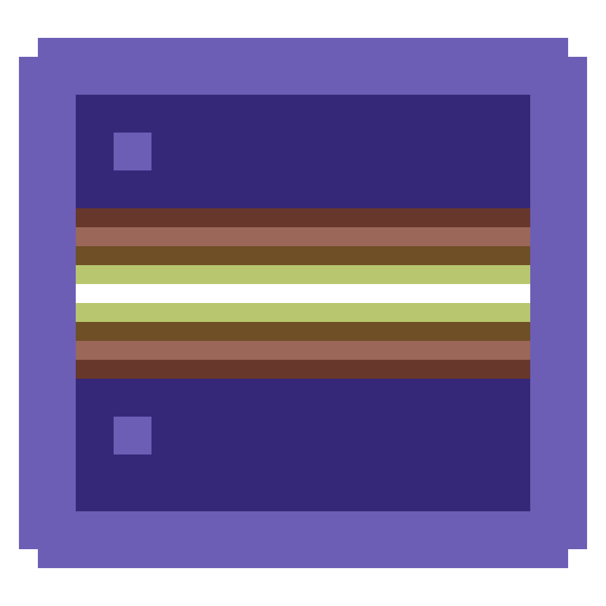

<p align="center"></p>

# Badline

**A cycle-accurate Commodore 64 emulator for Linux – built to be played, scripted and debugged.**

Badline is a fork of [**Denise**](https://github.com/piciji/denise), the
excellent C64 and Amiga emulator by **PiCiJi**. Denise did the hard part: a
cycle-exact C64 core, precise drive emulation, a slang shader pipeline and years
of careful accuracy work. Badline would not exist without it. Thank you, PiCiJi,
and thanks to everyone who contributed to Denise over the years.

Badline takes that core in a different direction: **C64 only, Linux only**, a
modern SDL3/Wayland front end, and first-class support for **automation and
development** – an embedded [MCP](https://modelcontextprotocol.io) server,
a headless mode for test pipelines and the VICE-compatible binary monitor.

> **Status: 0.1.0 – early preview.** The emulation is mature (it is Denise's),
> the front end is not yet. There is no settings UI at the moment – see
> [Current state](#current-state) before you try it.

*Why the name?* A **badline** is the raster line on which the VIC-II steals the
bus from the CPU to fetch character data – the moment every C64 coder learns to
count cycles around. It is where timing gets exact, and that is what this
project is about.

---

## Scope and goals

**What Badline is**

- A **pure C64 emulator**: C64/C64C (PAL/NTSC), 1541/1541-II/1541-C/1570/1571/1581
  drives, tape, cartridges and expansions – all from Denise's accurate core.
- **For players**: a lean window, fullscreen, gamepads, drag & drop, CRT shaders.
- **For developers and agents**: debug the C64 and its drives through MCP or the
  binary monitor, run it headless and unthrottled in CI, drive it from scripts
  or AI agents.

**Goals**

1. Keep the C64 core close to upstream Denise so accuracy fixes can be
   cherry-picked – the core is not ours to reinvent.
2. Replace the GTK GUI with a fast **in-window overlay** (keyboard/gamepad
   driven, C64 look) – no native dialogs.
3. Bring the debuggers into the overlay as a **split view** with a VICE-style
   **text monitor**, while keeping MCP and the binary monitor for external tools.
4. Stay small and Linux-native: Wayland first, SDL3, no Windows/macOS code paths.

**Non-goals**: Amiga emulation (removed), other Commodore machines, Windows/macOS.

---

## Current state

| Area | State in 0.1.0 |
|---|---|
| C64 emulation | Denise 2.9 core: cycle-exact VIC-II, reSID / libresidfp, CIA, drives with true drive emulation, tape, savestates, run-ahead |
| Media | D64, G64, P64, D71, G71, D81, TAP, T64, PRG, CRT, REU images; archives |
| Cartridges | EasyFlash, Retro Replay, Action Replay-type freezers, GMod, Final ChessCard, Trilogic Expert, REU, GeoRAM, SuperCPU and more (from Denise) |
| Window | SDL3, native Wayland (EGL) with X11 fallback, HiDPI, fullscreen (F11 / Alt+Enter), size remembered |
| Video | OpenGL 3.2 renderer, slang shaders (internal presets), optional render thread, VSync |
| Input | Keyboard (positional), mouse capture (middle button), gamepads with hotplug – the first pad drives joystick #1 |
| Drag & drop | Drop images onto the window: slot overlay for drive/autostart |
| Automation | Embedded MCP server, 30 tools; headless mode; VICE binary monitor (API v2) |
| Settings UI | **None yet.** Settings live in `~/.config/badline/*.ini` and can be changed via MCP. The overlay UI is the next milestone. |

**Known limitations**

- No settings or file dialogs yet (the old GTK dialogs are disconnected). Load
  software by drag & drop, on the command line or via MCP.
- Keyboard layouts: mapping is positional; some symbols are wrong on non-US
  layouts (e.g. `"` on German keyboards). A dedicated milestone will fix this.
- The bundled koko-aio bezel presets need the full koko-aio shader package;
  the internal presets work out of the box.
- No status bar (drive LEDs, track) until the overlay HUD arrives.
- GTK is still linked and initialized internally (no window is shown) until
  the GTK layer is removed; an X display (XWayland) is therefore required.

---

## ROMs

Badline does **not** include the Commodore ROMs – they are copyrighted by
their rights holders and not free software.

On first start Badline detects the missing ROMs and asks:

```
C64 ROMs missing. Return: download from zimmers.net   Esc: skip
```

Press **Return** and Badline downloads the original Kernal, BASIC, character
and drive ROMs from [zimmers.net](http://www.zimmers.net/anonftp/pub/cbm/firmware/)
(falling back to the VICE source mirror), verifies each file against a fixed
SHA-1 checksum and stores it in `~/.local/share/badline/roms/`. Nothing is
downloaded without your confirmation.

Alternatives:

- `badline -fetch-roms` – download non-interactively (scripts, headless).
- Copy your own ROMs into `~/.local/share/badline/roms/` (names `Kernal`,
  `Basic`, `Char`, `VC1541-II`, `VC1541`, `VC1541-C`, `VC1570`, `VC1571`,
  `VC1581`, or the usual zimmers/VICE file names such as `kernal.901227-03.bin`).
- `badline -rom-dir <path>` – use an additional ROM folder.

Using the ROMs is your responsibility.

---

## Building

Requirements (Arch Linux package names; other distributions are similar):

```
cmake gcc pkgconf sdl3 curl gtk3 libpulse freetype2 fontconfig libx11 libxrandr
optional: openal lame
```

```sh
cmake -B builds/release -DCMAKE_BUILD_TYPE=Release
cmake --build builds/release --parallel
./builds/release/program/badline
```

The build directory links the `data/` resources into `builds/release/share/badline`,
so the binary runs straight from the build tree. `cmake --install builds/release`
installs to `/usr/local` (binary, data, desktop file, icons; MIME types with `-DINSTALL_FILE_ASSOCIATIONS=1`).

---

## Usage

```sh
badline game.d64                 # autostart an image
badline -fullscreen demo.prg
badline -mcp                     # with MCP server on 127.0.0.1:6464
badline -headless -fetch-roms    # no window/audio, MCP on, ROM download
badline -headless -unthrottled   # as fast as possible (CI)
badline -binarymonitor           # VICE binary monitor for C64 Studio, VS64, ...
badline -help                    # all options
```

**Default keys**: F11 or Alt+Enter = fullscreen, middle mouse button = capture
mouse, numeric keypad = joystick #1 (8/2/4/6, 0 = fire). The C64 keyboard is
mapped by key position.

**Testing**: `tests/mcp_smoke.py` runs every MCP tool against a fresh instance
(`--headless` for the headless variant).

---

## MCP: let agents drive the C64

Start Badline with `-mcp [port]` (or `-headless`) and connect any MCP client to
`http://127.0.0.1:6464/mcp` (Streamable HTTP, localhost only). For Claude Code:

```sh
claude mcp add --transport http badline http://127.0.0.1:6464/mcp
```

Tools include:

- **Control & media**: `status`, `reset`, `pause`/`resume`, `warp`, `load_media`
  (with autostart), `eject`, `savestate_save`/`savestate_load`, `quit`
- **Input & observation**: `type_text`, `key`, `joystick`, `run_frames`,
  `wait_for_text`, `read_screen` (screen RAM as text), `screenshot` (raw or as
  rendered with shaders)
- **Debugging** (C64 and drives 8–11): `breakpoint_set/list/delete` (exec,
  read/write watchpoints, conditions, hit counts), `continue`, `break`, `step`
  (into/over/out), `registers`, `memory_read/write`, `load_memory`,
  `disassemble`, `cpu_history`, `chip_state` (VIC, SID, CIAs, VIAs)

---

## Roadmap

- **Overlay UI** (next): framework, then pages for media, savestates/reset,
  video/audio and system/input; status HUD.
- **Keyboard layouts**: correct symbolic/positional mapping for DE/US/FR.
- **Debugger in the overlay**: split view (picture + disassembler, registers,
  memory …) and a text monitor with VICE-like commands; label files.
- **Remove GTK** and the remaining native-window code.
- **SDL3 audio** evaluation (PipeWire) against the current PulseAudio driver.

See [CHANGELOG.md](CHANGELOG.md) for what changed since Denise.

---

## License and credits

Badline is licensed under the **GNU General Public License v3.0 or later**,
like Denise – see [LICENSE](LICENSE). Copyright of the original code remains
with PiCiJi and the Denise contributors; Badline's changes are © the Badline
contributors.

Third-party components (reSID, libresidfp, VICE-derived code, glslang,
SPIRV-Cross, cpp-httplib, fonts, sounds, shaders …) and their licenses are
listed in [NOTICE.md](NOTICE.md). The C64 Pro fonts by Style are included
unmodified under their own license.

Denise's original README and complete changelog are preserved in
[docs/DENISE-HISTORY.md](docs/DENISE-HISTORY.md). If you want the full
C64 **and** Amiga experience on Windows, macOS or Linux, use
[Denise](https://github.com/piciji/denise) – and consider supporting its author.
